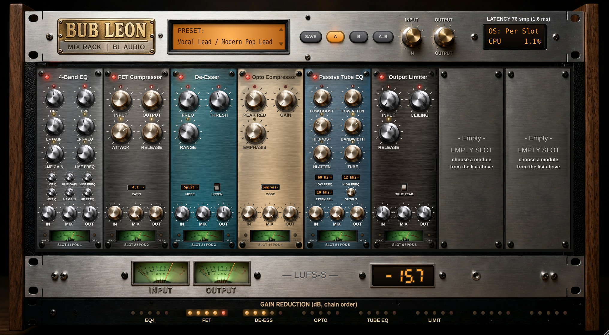

# Bub Leon Mix Rack

A modular channel-strip rack for **Windows x64 (VST3 + Standalone)** by BL Audio.
One plugin instance holds a chain of **8 slots**. You can load any of 12 built-in modules into each slot, reorder them by drag and drop, and bypass, solo, trim, blend and oversample each one. You can save single modules or the whole rack as presets.
All DSP, GUI artwork and module names are original.



- C++20, JUCE 8.0.4, CMake. Internal processing is 64-bit double precision, 44.1–192 kHz
- Layouts: mono, stereo, stereo-in/mono-out, mono-in/stereo-out
- Real-time safe audio thread: no locks, allocations or I/O. Modules are swapped lock-free (built on the message thread, handed over through atomic pointers, freed later on the message thread)
- Full latency compensation. Each slot's dry path is delayed to match its module, and the total is reported to the host
- Tested target host: Cubase 15 on Windows 11

## Download

Every push builds the plugin on GitHub Actions (**Actions → Build Windows x64 VST3 → artifact `BubLeonMixRack-Windows-x64`**).
Copy `Bub Leon Mix Rack.vst3` to `C:\Program Files\Common Files\VST3\` and rescan in Cubase.

## Build locally

```bat
cmake -S . -B build -A x64
cmake --build build --config Release --parallel
ctest --test-dir build -C Release --output-on-failure
```
Add `-DJUCE_DIR=C:\path\to\JUCE` to use a local JUCE checkout instead of fetching it.
Output: `build/BubLeonMixRack_artefacts/Release/VST3/Bub Leon Mix Rack.vst3`

## Using the rack

The GUI is a brushed-metal 19" rack built from the design artwork (`docs/design_reference.png`). The faceplates, knobs, paddle switches, VU meters and rack hardware are photographic elements cut from that image (`tools/mkskin3.py` regenerates them). Only the pointers, needles, LEDs, displays and text are drawn live.

| Element | What it does |
|---|---|
| **Module title** (top of each unit) | Click: load / swap / clear a module, save / load module presets (`.blmod`), copy / paste, reset. Drag the title onto another unit to move it to that chain position (automation follows the module). Right-click works too |
| Title LED | Module on / bypass, with a click-free 12 ms crossfade |
| Value LEDs above the knobs | Glow brighter as the knob turns up |
| Toggle switches / amber selectors | On/off controls (up = on) and multi-position controls |
| IN / MIX / OUT | Per-slot input trim, parallel dry/wet blend (latency aligned), output trim |
| VU meter | Slot output level (0 VU = −18 dBFS) |
| **SOLO** lamp / **OS** selector | Solo this module (all others are bypassed) / per-module oversampling 1x · 2x · 4x (Console Preamp, Passive Tube EQ, FET Compressor, Tape Saturator) |
| Preset LCD | Click: rack preset browser. ▲▼ arrows or mouse wheel: previous / next. Right-click: previous / next, save, init, **undo / redo**, open preset folder |
| SAVE · A · B · A=B | Save rack preset · compare settings A and B · copy the current setting to the other memory |
| INPUT / OUTPUT knobs | Global input / output gain |
| OS / CPU screen | Click to choose global oversampling (Per Slot / Off / 2x All / 4x All); shows CPU load |
| Bottom panel | Input / output VU meters, LUFS short-term readout (3 s, BS.1770), gain-reduction LEDs for every slot in chain order (1 / 3 / 6 / 10 / 15 dB) |

Knobs: drag to adjust, **Ctrl-drag** for fine control, **double-click** to reset, mouse wheel to step. The value shows while you drag and in the tooltip. Undo / redo also on **Ctrl+Z / Ctrl+Y** while the plugin window has focus.
The window can be resized from 1250 to 2500 px wide (drag the corner), and the size is saved with the project.

### Presets

- **Factory:** 32 presets in 6 banks: Vocal Lead, Vocal Background, Drum Bus, Bass, Mix Bus, Master Glue. They're gain-staged for material around −18 dBFS RMS
- **User racks:** `Documents\BL Audio\Mix Rack\Presets\*.blrack` (full rack state, XML)
- **Module presets:** `Documents\BL Audio\Mix Rack\Presets\Modules\*.blmod` (one module, values in real units, so they survive future range changes)

## Custom faceplate images

Every unit's brushed faceplate is built in. To use your own artwork for a module, put a PNG named after the module id in

```
Documents\BL Audio\Mix Rack\Faceplates\<module-id>.png
```

e.g. `vca.png`, `tubeeq.png`. Use **438 × 1206 px** (2× the 219 × 603 unit) for sharp results at full size. Knobs, labels and the VU meter are drawn on top: title at the top 50 px, controls from y 56 to 444, the IN/MIX/OUT row at 452 px and the VU meter at 540 px (unit coordinates). Module ids: `preamp eq4 tubeeq fet opto vca deess gate tape imager transient limiter v76`.

## Parameter map (host automation)

Each slot exposes 18 fixed parameters, so automation stays valid when you change modules:
`S<n> P1…P12` (generic module controls), `S<n> Bypass`, `S<n> Solo`, `S<n> Mix`, `S<n> Input Trim`, `S<n> Output Trim`, `S<n> Oversampling`.
Global controls: `Input Gain`, `Output Gain`, `Oversampling Mode` (Per Slot / Off / 2x All / 4x All). That makes 147 parameters in total.
Names and value text follow the loaded module (e.g. `S2 VCA Threshold = -12.0 dB`). The host is told when names change.
P-numbers map to module controls as follows:

#### Console Preamp (`preamp`, Color, oversampling)

| # | Control | Range | Default |
|---|---|---|---|
| P1 | Drive | 0.0 dB … 24.0 dB | 0.0 dB |
| P2 | Tilt | -6.0 dB … 6.0 dB | 0.0 dB |
| P3 | Color | Clean / Iron / Tube | Iron |
| P4 | Low Cut | Off … 250 Hz | Off |
| P5 | Output | -18.0 dB … 6.0 dB | 0.0 dB |

#### 4-Band EQ (`eq4`, EQ)

| # | Control | Range | Default |
|---|---|---|---|
| P1 | High Pass | Off … 500 Hz | Off |
| P2 | Low Pass | 3.00 kHz … Off | Off |
| P3 | Low Gain | -15.0 dB … 15.0 dB | 0.0 dB |
| P4 | Low Freq | 30 Hz … 450 Hz | 100 Hz |
| P5 | Low-Mid Gain | -15.0 dB … 15.0 dB | 0.0 dB |
| P6 | Low-Mid Freq | 200 Hz … 2.50 kHz | 600 Hz |
| P7 | Low-Mid Q | 0.40 … 4.00 | 0.90 |
| P8 | High-Mid Gain | -15.0 dB … 15.0 dB | 0.0 dB |
| P9 | High-Mid Freq | 600 Hz … 7.00 kHz | 2.50 kHz |
| P10 | High-Mid Q | 0.40 … 4.00 | 0.90 |
| P11 | High Gain | -15.0 dB … 15.0 dB | 0.0 dB |
| P12 | High Freq | 1.50 kHz … 16.0 kHz | 8.00 kHz |

#### Passive Tube EQ (`tubeeq`, EQ, oversampling)

| # | Control | Range | Default |
|---|---|---|---|
| P1 | Low Freq | 20 Hz / 30 Hz / 60 Hz / 100 Hz | 60 Hz |
| P2 | Low Boost | 0.0 … 10.0 | 0.0 |
| P3 | Low Atten | 0.0 … 10.0 | 0.0 |
| P4 | High Freq | 3 kHz / 4 kHz / 5 kHz / 8 kHz / 10 kHz / 12 kHz / 16 kHz | 8 kHz |
| P5 | High Boost | 0.0 … 10.0 | 0.0 |
| P6 | Bandwidth | 0.0 … 10.0 | 5.0 |
| P7 | Atten Freq | 5 kHz / 10 kHz / 20 kHz | 10 kHz |
| P8 | High Atten | 0.0 … 10.0 | 0.0 |
| P9 | Tube Drive | 0.0 … 10.0 | 2.0 |
| P10 | Output | -12.0 dB … 6.0 dB | 0.0 dB |

#### FET Compressor (`fet`, Dynamics, oversampling)

| # | Control | Range | Default |
|---|---|---|---|
| P1 | Input | 0.0 dB … 48.0 dB | 0.0 dB |
| P2 | Output | -24.0 dB … 24.0 dB | 0.0 dB |
| P3 | Attack | 20 us … 800 us | 200 us |
| P4 | Release | 50 ms … 1.10 s | 400 ms |
| P5 | Ratio | 4:1 / 8:1 / 12:1 / 20:1 / All | 4:1 |

#### Opto Compressor (`opto`, Dynamics)

| # | Control | Range | Default |
|---|---|---|---|
| P1 | Peak Reduction | 0 … 100 | 0 |
| P2 | Gain | 0.0 dB … 40.0 dB | 0.0 dB |
| P3 | Mode | Compress / Limit | Compress |
| P4 | Emphasis | 0 % … 100 % | 0 % |

#### VCA Bus Comp (`vca`, Dynamics)

| # | Control | Range | Default |
|---|---|---|---|
| P1 | Threshold | -40.0 dB … 0.0 dB | 0.0 dB |
| P2 | Ratio | 1.5:1 / 2:1 / 4:1 / 10:1 | 2:1 |
| P3 | Attack | 0.1 ms / 0.3 ms / 1 ms / 3 ms / 10 ms / 30 ms | 10 ms |
| P4 | Release | 0.1 s / 0.3 s / 0.6 s / 1.2 s / Auto | Auto |
| P5 | Makeup | 0.0 dB … 20.0 dB | 0.0 dB |
| P6 | SC High Pass | Off … 400 Hz | Off |

#### De-Esser (`deess`, Dynamics)

| # | Control | Range | Default |
|---|---|---|---|
| P1 | Frequency | 2.00 kHz … 12.0 kHz | 6.00 kHz |
| P2 | Threshold | -60.0 dB … 0.0 dB | -30.0 dB |
| P3 | Range | 0.0 dB … 24.0 dB | 8.0 dB |
| P4 | Mode | Split / Wide | Split |
| P5 | Listen | Off / On | Off |

#### Gate / Expander (`gate`, Dynamics)

| # | Control | Range | Default |
|---|---|---|---|
| P1 | Threshold | -80.0 dB … 0.0 dB | -60.0 dB |
| P2 | Range | 0 dB … 80 dB | 40 dB |
| P3 | Mode | Gate / Exp 1:2 / Exp 1:4 | Gate |
| P4 | Attack | 50 us … 50.00 ms | 500 us |
| P5 | Hold | 0 us … 500 ms | 30 ms |
| P6 | Release | 5 ms … 2.00 s | 120 ms |
| P7 | Hysteresis | 0.0 dB … 12.0 dB | 3.0 dB |
| P8 | SC High Pass | Off … 2.00 kHz | Off |
| P9 | SC Low Pass | 1.00 kHz … Off | Off |

#### Tape Saturator (`tape`, Color, oversampling)

| # | Control | Range | Default |
|---|---|---|---|
| P1 | Drive | -12.0 dB … 18.0 dB | 0.0 dB |
| P2 | Bias | -100 % … 100 % | 0 % |
| P3 | Head Bump | 0 % … 100 % | 50 % |
| P4 | Speed | 7.5 ips / 15 ips / 30 ips | 15 ips |
| P5 | Wow/Flutter | 0 % … 100 % | 0 % |
| P6 | Hiss | Off / On | Off |
| P7 | Output | -18.0 dB … 12.0 dB | 0.0 dB |

#### Stereo Imager (`imager`, Utility)

| # | Control | Range | Default |
|---|---|---|---|
| P1 | Width | 0 % … 200 % | 100 % |
| P2 | Mono Bass | Off … 300 Hz | Off |
| P3 | M/S Balance | -100 % … 100 % | 0 % |
| P4 | Output | -12.0 dB … 12.0 dB | 0.0 dB |

#### Transient Shaper (`transient`, Dynamics)

| # | Control | Range | Default |
|---|---|---|---|
| P1 | Attack | -100 % … 100 % | 0 % |
| P2 | Sustain | -100 % … 100 % | 0 % |
| P3 | Speed | Fast / Medium / Slow | Medium |
| P4 | Output | -12.0 dB … 12.0 dB | 0.0 dB |

#### Output Limiter (`limiter`, Dynamics)

| # | Control | Range | Default |
|---|---|---|---|
| P1 | Input | 0.0 dB … 24.0 dB | 0.0 dB |
| P2 | Ceiling | -12.0 dB … 0.0 dB | -0.3 dB |
| P3 | Release | 1 ms … 1.00 s | 80 ms |
| P4 | True Peak | Off / On | On |

#### Vintage 76 Pre (`v76`, Color, oversampling)

| # | Control | Range | Default |
|---|---|---|---|
| P1 | Gain | 0 dB … 30 dB | 6 dB |
| P2 | Stages | 1 Stage / 2 Stages | 2 Stages |
| P3 | Iron | 0 % … 100 % | 50 % |
| P4 | Tube Age | New / Vintage / Worn | Vintage |
| P5 | Low Cut | Off / 40 Hz / 80 Hz / 120 Hz | Off |
| P6 | High Cut | Off / 15 kHz / 10 kHz | Off |
| P7 | Hum | Off / On | Off |
| P8 | Output | -24.0 dB … 6.0 dB | 0.0 dB |

### Vintage 76 Pre: how the algorithm works

A model of a classic two-stage German broadcast tube preamp (V76-style), built from these stages:
1. **Input transformer:** the low band (<140 Hz) saturates with the core (amount = *Iron*). It has a slight resonant HF lift.
2. **Two inverting triode stages:** the gain is split between them, with a coupling capacitor (18 Hz) and Miller roll-off in between. Each triode has a biased transfer curve (even harmonics) and earlier grid-current limiting on the positive half. Because the second stage is inverted, part of the first stage's even harmonics cancel out, as in the real circuit. *1 Stage* gives a simpler, more even-harmonic sound.
3. **Power-supply sag:** under load, the B+ voltage drops and gain falls a little, giving soft program-dependent compression at high gain.
4. **Output transformer:** gentler LF saturation and a 14 Hz LF limit.
5. **Tube Age:** *New / Vintage / Worn* raises bias asymmetry, grid-current limiting, sag and tube hiss (−104 / −92 / −84 dBFS).
6. **Gain** works in 2 dB steps, like the original's switch. Gain is level-compensated, so *Gain* changes the character and *Output* sets the level.
7. **Extras:** low cut (40/80/120 Hz), high cut (15/10 kHz) and optional 50 Hz mains hum (−74 dBFS).

It is oversampling-capable (2x/4x recommended at high gain). Measured at −12 dBFS: 0.13 % THD at 0 dB gain, rising to about 17 % at +30 dB.

## Architecture

```
Source/
  DSP/        Common.h (biquads, smoothing, soft clip, delay line), Meters.h (peak/RMS/LUFS-S)
  Engine/     ModuleBase.h (module + ParamSpec interface), ModuleRegistry.h, RackEngine.h (slots, swaps, OS, latency)
  Modules/    Color, EQ, Dynamics, Utility, Limiter modules
  GUI/        Skin.h (rack skin, LCD / 7-segment / VU drawing), RackLookAndFeel.h, Widgets.h, ModuleUnit
Resources/skin/  background and brushed faceplates (embedded via juce_add_binary_data)
  Presets/    FactoryPresets (30 rack presets)
  PluginProcessor / PluginEditor
tests/rack_test.cpp   null test, latency alignment, limiter ceiling, state recall,
                      all modules × 3 sample rates × 3 OS factors, factory presets, layouts, double path, undo
```

- **Slot swap:** `RackSlot::build()` (message thread) creates and prepares the module at the right rate → `install()` puts it in `pending` → the audio thread exchanges it at the next block start and moves the old one to `trash` → the processor timer deletes `trash`.
- **Chain order** is a packed `std::atomic<uint32_t>` (8 × 4 bits), so reordering never blocks audio.
- **Bypass null test:** with every module bypassed, the output equals the input delayed by the reported latency, bit-exact (checked in CI).
